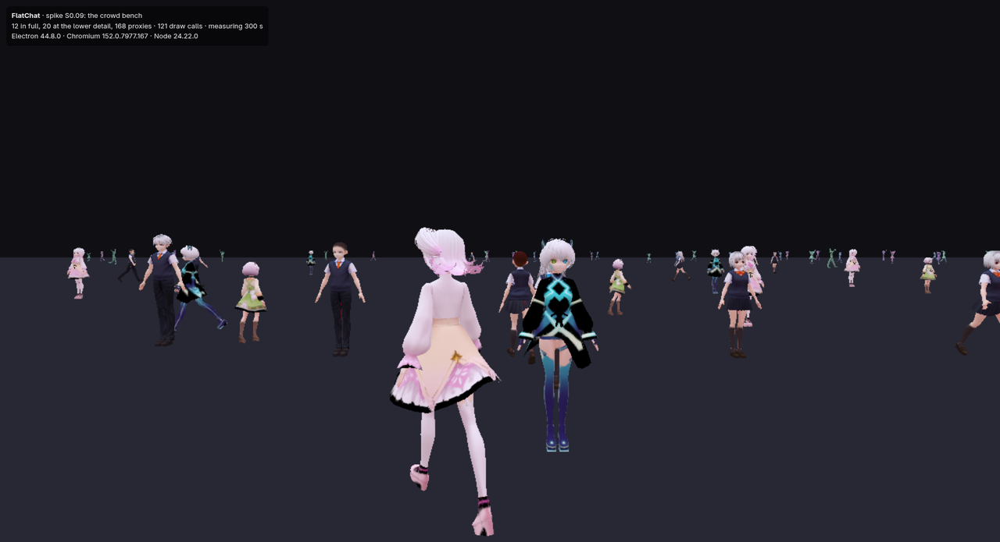

# S-AVATAR: crowds on a weak laptop (spike S0.09)

**Question.** How many avatars can the client draw on a weak laptop (an Intel Iris Xe or AMD Radeon 680M class) at 30 frames per second, with a full room around the player?

**Status.** The crowd bench is built, and measured on the desktop on 2026-10-17. On the desktop the plan's crowd passes every line with room to spare, and so does 200 present. The frame is set by the main thread's CPU, not the GPU, so the stand-in runs should land close to these numbers. The pass lines are judged on the Iris Xe and 680M stand-ins, which lock the graphics clock with sudo and are the owner's runs (OQ-23); the commands are at the end.



## The pass lines (the plan's crowd: 12 full, 20 at the lower detail, 55 present)

| Pass line | Desktop, 5 minutes | On the stand-in (headroom 1.5, OQ-24) |
|---|---|---|
| Frame time p95 ≤ 33.3 ms with at least 8 full avatars | 12.5 ms with 12 full · **PASS** | the line is 22.2 ms: the owner's run |
| No frame over 100 ms after the warm-up, including while an avatar loads | 69.6 ms (the first draw of a new avatar's mesh; 19 avatars arrived) · **PASS** | the line is 66.7 ms: the owner's run (the first draw of a new avatar's mesh is near it) |
| Process memory ≤ 2 GB | 1,526 MB for every FlatChat process together · **PASS** | the same client: the owner's run |
| The largest number of full avatars that holds 30 fps | more than 48 on the desktop (48 full: p95 24.6 ms) | the owner's run |
| Kill line: fewer than 8 full at 30 fps on the 680M profile | not near it | the owner's run, then a real laptop |

With 200 present (12 full, 20 at the lower detail, 168 proxies): p95 19.2 ms, the worst frame 87.7 ms, 1,476 MB, every line passing on the desktop; the proxies cost main-thread time as objects (the render call went from 9 to 15 ms), not GPU time.

## The bench

`--crowd=SECONDS --avatars=DIR` draws a crowd of the folder's VRM avatars on three.js's WebGPU renderer at a fixed 1280×720 on the "low" preset (no antialiasing, shadows or outlines), with no frame-rate cap, so each frame time is the work. The player stands at the origin looking into the crowd:

| Tier | Where | Drawn as | Animated |
|---|---|---|---|
| Full (12) | 2.5 to 12 m, all in view | the whole avatar: merged materials, its textures within 16 MB | every frame; spring bones on the nearest 6; walking or idling |
| Lower detail (20) | 15 to 45 m | simplified with meshoptimizer to 30 % of its triangles, textures within 4 MB, no blend shapes | at 15 Hz |
| Proxies (the rest) | 50 to 120 m, all around | one mesh of about 1,500 triangles on the humanoid bones only, one flat colour, shared by every proxy of that avatar | at 5 Hz |

After a 5-second warm-up it measures for the given time; every 15 seconds the farthest full avatar is replaced by a freshly loaded one. A swap paces its work over frames as the game must: load and parse; merge the materials and fit the textures, one image per frame; upload one texture per frame; compile the pipelines; show the meshes one per frame. Each frame records which step was under way. The main process serves the folder read-only (`flatchat-avatar://bench/`) and samples every process's memory each second. The report has the frame times, the main thread's time per frame (updating the avatars, and the render call), the GPU's time per frame from WebGPU timestamp queries, draw calls, triangles, each tier's make-up, every swap's steps, memory, and the pass lines.

## What the converter must do

There is no converter yet (Stage 4), and no openly licensed avatar matches the plan's test avatar (VRM 1.0, 20,000 to 30,000 triangles, at most 3 materials). So the bench takes the VRoid Project's sample avatars, which have the right triangle count (26,700 to 39,500) and 15 to 17 materials each, and does at load time what decides the converter's cost:

- **Materials merged.** The parts that share the skeleton are grouped by how they blend (opaque, cut-out, blended), and each group becomes one mesh with one material whose colour is an atlas of its parts' textures. As exported, the plan's crowd drew 1,848 times a frame and missed 30 fps even on the desktop (p95 42.9 ms); merged, 85 times, at 87 fps. The draw calls, not the triangles, decided it.
- **Textures within a budget.** As exported, a VRoid avatar decodes to about 110 MB of textures. A full avatar here gets 16 MB (the plan's 3-material avatar as three 2,048 px KTX2 textures with mipmaps), the lower detail 4 MB.
- **One texture object per image.** three-vrm makes a texture object for each material slot, and three.js's WebGPU renderer uploads every texture object on its own: 68 to 72 uploads from 28 images per avatar, now 26.

Blend shapes are not kept on merged avatars (the mouth shapes are a handful on the face); the converter will keep the visemes.

## Measured on the desktop

The desktop: Intel Core i7-9700K, NVIDIA GeForce GTX 1660 SUPER, Linux, the packaged client.

| Run | Full / lower / proxies | Draw calls | Triangles | Frame p50 / p95 / p99 (ms) | Worst (ms) | Over 50 ms | Main thread: update / render (ms, p50) | Memory (MB) |
|---|---|---|---|---|---|---|---|---|
| The plan's crowd, 5 minutes | 12 / 20 / 23 | 85 | 479,883 | 11.5 / 12.5 / 14.8 | 69.6 | 9 | 2.3 / 8.9 | 1,526 |
| 200 present, 5 minutes | 12 / 20 / 168 | 121 | 533,830 | 18.0 / 19.2 / 24.1 | 87.7 | 31 | 2.4 / 15.3 | 1,476 |
| As exported (no merge), 1 minute | 12 / 20 / 23 | 1,848 | 476,593 | 39.6 / 42.9 / 64.9 | 109.5 | 26 | 2.9 / 36.4 | 1,692 |
| 100Avatars (about 3,900 triangles, 1 material), 1 minute | 12 / 20 / 23 | 33 | 68,161 | 3.1 / 3.6 / 4.0 | 18.8 | 0 | 0.4 / 2.6 | 1,012 |
| 16 full, 1 minute | 16 / 20 / 23 | 98 | 589,807 | 12.1 / 13.2 / 14.4 | 54.1 | 3 | 2.1 / 9.8 | 1,459 |
| 24 full, 1 minute | 24 / 20 / 23 | 118 | 799,717 | 15.2 / 16.2 / 17.4 | 62.8 | 3 | 3.0 / 11.9 | 1,495 |
| 32 full, 1 minute | 32 / 20 / 23 | 138 | 1,026,876 | 18.1 / 19.3 / 21.9 | 63.7 | 5 | 3.7 / 13.9 | 1,624 |
| 48 full, 1 minute | 48 / 20 / 23 | 201 | 1,540,404 | 23.0 / 24.6 / 29.3 | 66.3 | 9 | 4.0 / 18.6 | 1,935 |

**The main thread sets the frame.** In the plan's crowd the GPU spends 0.46 ms on a typical frame (2.3 ms at p95; with 200 present, 2.2 ms) while the main thread spends about 11 ms, most of it in three.js's render call: about 80 µs for each skinned object it draws. The 168 proxies of the 200-present run cost more than their triangles because each is an object. Spring bones on six VRoid avatars cost about 1.6 ms a frame. Refreshing the far tiers' transforms less often did not help.

**Arrivals.** Before pacing, a swap stalled frames for up to 184 ms. Paced, the worst frame of each step in the plan's crowd: load and parse 46.5 ms, merging and fitting 48.8 ms, uploading 31.1 ms, compiling 44.6 ms, and the first draw of each new mesh 69.6 ms (87.7 ms with 200 present), which three.js spends on the mesh's first draw even after `compileAsync`. Garbage collection is not it (V8's longest pause in a traced run: 5.8 ms).

## The stand-in runs (the owner)

On the desktop, with the client built (`npm run dist:linux -w @flatchat/client`) and the avatars in `~/.cache/flatchat/avatars/vroid-cc0`:

```sh
npm run standin -- run --target iris-xe --seconds 300 --crowd ~/.cache/flatchat/avatars/vroid-cc0
npm run standin -- run --target 680m --seconds 300 --crowd ~/.cache/flatchat/avatars/vroid-cc0
npm run standin -- run --target 680m --seconds 60 --crowd ~/.cache/flatchat/avatars/vroid-cc0 --full 16   # and 24, 32: the most full avatars at 30 fps
```

Each asks for sudo once, locks the graphics clock, runs the client on four capped cores, resets the clocks, and prints the pass lines with the profile's headroom (frame p95 ≤ 22.2 ms, worst frame ≤ 66.7 ms). Because the bench is CPU-bound and the stand-in caps cores but not the main thread's speed, the frame times should stay close to the desktop's; the first draw of a new avatar's mesh (up to 69 ms here) is the line most at risk.

## The avatars

Neither set is stored in the repository or shipped:

- **VRoid Studio samples** by the VRoid Project (pixiv): eight VRM 0.x avatars from [OpenGameArt](https://opengameart.org/content/vroid-studio-cc0-models), stated there as CC0; in their own files two say CC0 and six point to VRoid Hub conditions that allow anyone to use, modify and redistribute them commercially without credit. The bench keeps them in `~/.cache/flatchat/avatars/vroid-cc0` with a manifest of SHA-256 sums.
- **100Avatars R1** by Polygonal Mind: sixty VRM 0.x avatars under CC0, from [opensourceavatars.com](https://github.com/toxsam/open-source-avatars), in `~/.cache/flatchat/avatars/100avatars`.

## Reproduce

```sh
npm run dist:linux -w @flatchat/client
apps/client/release/linux-unpacked/flatchat --crowd=300 --avatars=DIR --crowd-out=crowd.json --crowd-shot=crowd.png
apps/client/release/linux-unpacked/flatchat --crowd=300 --avatars=DIR --crowd-present=200 --crowd-out=crowd-200.json
apps/client/release/linux-unpacked/flatchat --crowd=60 --avatars=DIR --crowd-merge=0 --crowd-out=exported.json
```

Every option is in `apps/client/src/main/flags.ts`; the engine skill's rule `avatars-and-crowds` explains them.
