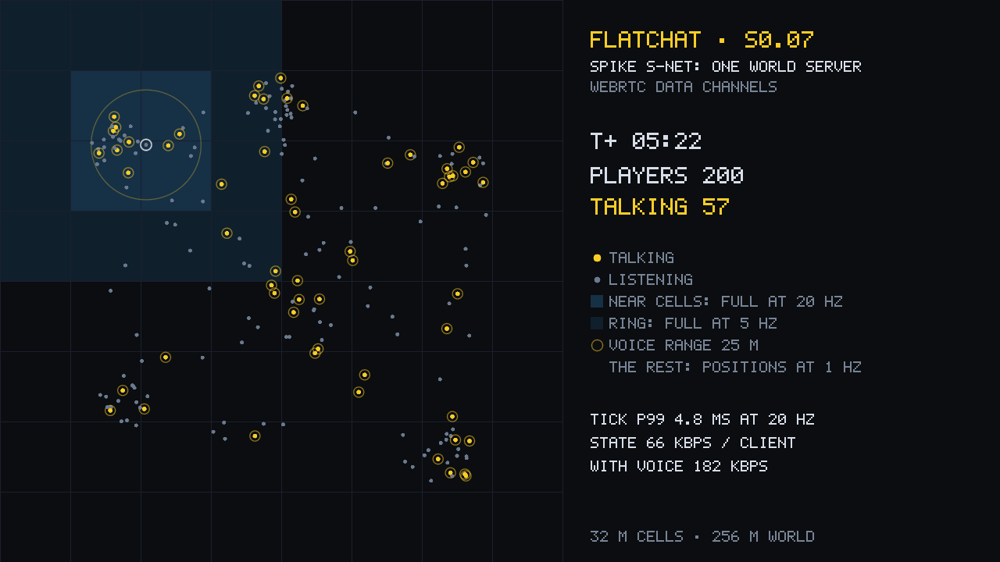

# S-NET: 200 players on one world server (spike S0.07)

**Question.** Can one world server on an ordinary PC hold 200 players for half an hour, sending each of them what they need (avatars near and far, voice, chat) within a home connection's budget? And which transport should carry it: WebRTC data channels or raw UDP with our own encryption (DR-07)?

**Answer.** Yes, on both transports, by every line of the plan. WebRTC data channels stay the transport (DR-07); raw UDP is measured and kept as the fallback. Measured on 2026-10-17 on the desktop.



## The pass lines, 200 bots for 30 minutes

| Pass line | Limit | Raw UDP | WebRTC |
|---|---|---|---|
| 30 minutes, every bot joined, none disconnected | 30 min, 0 lost | 200 of 200 joined, 0 lost · **PASS** | 200 of 200 joined, 0 lost · **PASS** |
| Server tick p99 at 20 Hz | ≤ 15 ms | 4.73 ms · **PASS** | 4.78 ms · **PASS** |
| Per-client download without voice (p95 of clients) | ≤ 350 kbps | 69.9 kbps · **PASS** | 69.6 kbps · **PASS** |
| Per-client download with voice (p95 of clients) | ≤ 750 kbps | 198.1 kbps · **PASS** | 199.0 kbps · **PASS** |
| Serialisations per tick follow the busy cells, not the clients | ≤ 2 per busy cell | 65.8 for 32.9 busy cells (2.00 each) · **PASS** | 65.6 for 32.8 busy cells (2.00 each) · **PASS** |
| Join snapshot | ≤ 64 KB | 1.87 KB (the full roster beside it: 5.17 KB) · **PASS** | 1.90 KB (roster 5.17 KB) · **PASS** |
| Server upload at 50 bots | ≤ 30 Mbps | 3.98 Mbps on the wire · **PASS** | 5.02 Mbps on the wire · **PASS** |
| Server upload at 200 bots | logged | 43.4 Mbps on the wire | 48.8 Mbps on the wire |
| Memory growth once settled | < 10 % | −1 % (276.7 → 273.8 MB) · **PASS** | 25.8 % by the 5-minute rule, from one late step of V8's young generation; flat after it, and gone with the young generation fixed at 16 MB (below) · **PASS** with that setting |

## Every run

The hubs scenario: the bots walk between six gathering places, idle, sometimes run or sit, and talk about a quarter of the time. The crowd scenario puts all 200 in one place, past what the plan expects. The netem runs add a real network's delay and loss.

| Run | Joined / lost | Tick p50 / p99 / max (ms) | Voice step p99 (ms) | Server CPU, all threads / main thread (% of one core) | State down per client (kbps: mean, p95) | With voice (kbps: mean, p95) | Server up: messages / wire (Mbps) | Round trip p50 / p99 (ms) | Memory |
|---|---|---|---|---|---|---|---|---|---|
| Raw UDP, 200 bots, 30 min, hubs | 200 / 0 | 2.64 / 4.73 / 22.0 | 4.17 | 39.3 / 37.1 | 65.8, 69.9 | 181.3, 198.1 | 36.29 / 43.36 | 1 / 8 | −1.0 % from 5 min (276.7 → 273.8 MB) |
| WebRTC, 200 bots, 30 min, hubs | 200 / 0 | 3.23 / 4.78 / 10.1 | 4.55 | 59.0 / 32.5 | 65.9, 69.6 | 182.2, 199.0 | 36.48 / 48.80 | 1 / 7 | 25.8 % from 5 min (238.6 → 300.1 MB) |
| WebRTC, 200 bots, 30 min, hubs, young generation 16 MB | 200 / 0 | 3.26 / 4.63 / 7.7 | 4.39 | 58.5 / 32.2 | 66.2, 70.2 | 184.1, 203.7 | 36.85 / 49.17 | 1 / 7 | 2.7 % from 5 min (213.4 → 219.1 MB) |
| Raw UDP, 50 bots, 5 min, hubs | 50 / 0 | 0.62 / 0.91 / 2.7 | 0.50 | 8.4 / 7.9 | 23.0, 29.2 | 54.3, 79.4 | 2.70 / 3.98 | 0 / 1 | too short to judge |
| WebRTC, 50 bots, 5 min, hubs | 50 / 0 | 0.73 / 1.10 / 1.8 | 0.66 | 14.7 / 5.9 | 22.2, 27.1 | 51.0, 73.4 | 2.54 / 5.02 | 0 / 2 | too short to judge |
| Raw UDP, 200 bots, 5 min, crowd | 200 / 0 | 4.17 / 10.32 / 12.6 | 10.14 | 75.4 / 72.2 | 279.7, 294.3 | 689.5, 738.4 | 138.91 / 148.61 | 5 / 28 | too short to judge |
| WebRTC, 200 bots, 5 min, crowd | 200 / 0 | 4.51 / 7.07 / 9.5 | 13.09 | 99.0 / 64.6 | 279.6, 294.1 | 689.4, 739.6 | 138.85 / 160.45 | 3 / 18 | too short to judge |
| Raw UDP, 200 bots, 5 min, hubs, netem `delay 20ms 2ms loss 1%` | 200 / 0 | 2.78 / 4.71 / 7.0 | 3.89 | 42.7 / 39.9 | 65.0, 76.1 | 171.3, 212.2 | 34.76 / 41.76 | 41 / 48 | too short to judge |
| WebRTC, 200 bots, 5 min, hubs, netem `delay 20ms 2ms loss 1%` | 200 / 0 | 3.03 / 4.36 / 9.1 | 4.15 | 77.0 / 36.0 | 64.6, 76.1 | 169.7, 219.8 | 34.44 / 47.28 | 40 / 54 | too short to judge |

Serialisations against clients: with 50 bots the server encodes 1.92 to 1.93 cell blocks per busy cell per tick, with 200 bots 2.00 (one full and one coarse encoding of each busy cell, shared by everyone who sees it), and in the crowd 1.70 (fewer busy cells, each needed in fewer forms). The join snapshot stays under 2 KB because it carries positions and the roster carries the names.

## Memory

The JavaScript heap does not grow: its floor (the smallest heap in each five minutes, the live data after a collection) stays at 10 to 12 MB through both 30-minute runs. What moved is the resident memory, in steps, as V8 enlarged its young generation for the server's allocation rate (every tick encodes fresh snapshot bytes):

| Run | Minutes | Resident memory, largest in the window (MB) | Heap floor, smallest in the window (MB) |
|---|---|---|---|
| Raw UDP | 0–5 | 276.7 | 10.3 |
| | 5–10 | 279.1 | 10.0 |
| | 10–15 | 271.2 | 10.1 |
| | 15–20 | 271.7 | 10.4 |
| | 20–25 | 273.1 | 10.1 |
| | 25–30 | 273.7 | 12.1 |
| WebRTC | 0–5 | 238.6 | 11.4 |
| | 5–10 | 297.7 | 10.9 |
| | 10–15 | 298.1 | 10.8 |
| | 15–20 | 298.6 | 12.4 |
| | 20–25 | 299.5 | 11.5 |
| | 25–30 | 300.0 | 11.4 |
| WebRTC, young generation 16 MB | 0–5 | 216.2 | 12.5 |
| | 5–10 | 216.3 | 11.1 |
| | 10–15 | 216.6 | 12.4 |
| | 15–20 | 216.7 | 11.3 |
| | 20–25 | 218.1 | 12.4 |
| | 25–30 | 218.8 | 11.5 |

The raw UDP server took its step in the first minutes, so the 5-minute baseline saw only flat memory. The WebRTC server took two: one at 2.5 minutes and one at 5.5 minutes, just after the baseline, so the rule read the second step as 25.8 % growth; after it, memory rose 2.4 MB in 24 minutes (0.8 %). A third 30-minute WebRTC run started the server with V8's young generation fixed at 16 MB per semi-space (`--min-semi-space-size=16 --max-semi-space-size=16`): no step, 2.7 % from the 5-minute mark (213.4 → 219.1 MB), every other line as before (tick p99 4.63 ms, the voice step 4.39 ms, 58.5 % of one core), and about 80 MB less memory than V8's default. The world server now starts with that setting (`npm run server`, the bots' runs and the lounge). What is left is a slow rise of about 1.4 MB per 10 minutes outside the heap (Node's external memory went from 12.2 to 14.6 MB), which a multi-hour soak in Stage 1 should watch.

## The two transports

| | Raw UDP, our own encryption | WebRTC data channels |
|---|---|---|
| Tick p99 at 200 | 4.73 ms | 4.78 ms |
| Server CPU at 200, hubs | 39 % of one core, nearly all on the main thread | 59 %, a third of it on the main thread and the rest on libdatachannel's threads (encryption, SCTP) |
| In the crowd | 75 %, the main thread at 72 %: tick p99 10.3 ms | 99 %, the main thread at 65 %: tick p99 7.1 ms |
| Overhead on the wire | ×1.19 of the message bytes | ×1.34 (DTLS and SCTP headers) |
| Reaching players behind NAT | no: needs our own hole punching and relay | ICE: host, reflexive and relayed candidates, one UDP port |
| In the client | needs a native network process (the page cannot open UDP sockets) and a new session-key exchange in the protocol | Chromium's own `RTCPeerConnection`, nothing native |

**Decision: WebRTC data channels (DR-07 stands).** It costs 12 % more upload and 50 % more server CPU at 200 players, all well inside the budget, and gives NAT traversal (which S0.10's home hosting needs) and a client with no native networking code. Raw UDP stays in `apps/world-server/src/net/udp.ts`, measured, as the fallback for dedicated servers if relays or CPU ever bind.

## How it was measured

- **The world server** is the prototype in `apps/world-server`: joins with connect tokens and the version handshake, poses checked and corrected, interest management in 32 m cells (near cells in full at 20 Hz, the ring to 50 m in full at 5 Hz, everything else as coarse positions at 1 Hz), every busy cell encoded once per form per tick and the bytes shared, proximity voice forwarded every 20 ms (one frame from each of the nearest 16 speakers within 25 m), chat within 50 m. It ran on two of the desktop's eight cores (`taskset -c 0-1`).
- **The bots** (`tools/bots`) are headless players on the real protocol and the real transport: each seals its own connect token (standing in for the core), joins, moves between six gathering places (walking 1.4 m/s, sometimes running 4 m/s, idling, some sitting), sends its pose at 20 Hz, talks about a quarter of the time in bursts of synthetic Opus-sized frames (50 to 80 bytes every 20 ms) with mouth shapes, chats now and then, pings every second, and decodes everything the server sends. Four bot processes shared the other six cores, so the bots never ran on the server's cores.
- **The network** was a rootless user and network namespace (`unshare -Urn`): only its own loopback, its MTU set to 1,500, nftables counting every datagram to and from the server's port with IP and UDP headers. Nothing else's traffic mixed in, and nothing on the machine changed. Two runs added a real network's delay and loss with netem.
- **The pass lines** are the MVP plan's: 30 minutes with no disconnects; the server's tick p99 at most 15 ms at 20 Hz; per-client download at most 350 kbps without voice and 750 kbps with it (judged on the 95th percentile of the clients); serialisations per tick that follow the busy cells, not the clients; a join snapshot of at most 64 KB; the server's upload logged at 50 and 200 bots (at most 30 Mbps at 50); memory growth under 10 %.
- **Memory** is judged on the server's resident memory from the 5-minute mark to the end, with its trend; the heap floor per five minutes shows whether live data grows.

## Found and fixed on the way

- **The protocol handed out views, not copies.** Decoding a message from a Node.js `Buffer` (what the UDP socket gives) returned its byte strings as views into the packet, because `Buffer`'s `slice()` returns a view where `Uint8Array`'s copies. The codec now copies with `new Uint8Array(view)`, and a test pins it. No byte on the wire changed.
- **Both ends of a WebRTC connection made an offer.** libdatachannel negotiates as soon as a data channel exists, so a server that created its pre-negotiated channels before reading the client's offer made an offer of its own; both ends then acted as the DTLS client and every handshake failed with "unexpected message". The server now sets the remote offer first.
- **A send on a closing WebRTC channel threw.** `sendMessageBinary` throws (EPIPE) instead of returning false once a connection is going down; in the first 50-bot WebRTC run that killed a bot process during shutdown and 13 bots vanished from its report. The link now catches it and closes, and a stopping bot stops sending.
- **The first chat line of a fresh server was throttled.** The once-a-second chat limit started counting at time 0 of a process clock that starts near 0. It now starts at minus infinity.
- **The spawn could be lost** (found by S0.08's voice test): the server sent each player's spawn once, in a snapshot on the unreliable channel. It now repeats it until the player's first pose arrives.

## Reproduce

From the repository, on Linux, with nothing else heavy running:

```sh
npm run bots -- run --transport rtc --bots 200 --minutes 30 --server-cpus 0-1 --bot-cpus 2-7 --trace --out tools/bots/out/s007/rtc-200-hubs
npm run bots -- run --transport udp --bots 200 --minutes 5 --scenario crowd --server-cpus 0-1 --bot-cpus 2-7
npm run bots -- run --transport rtc --bots 200 --minutes 5 --netem "delay 20ms 2ms loss 1%" --server-cpus 0-1 --bot-cpus 2-7
npm run bots -- report tools/bots/out/s007/rtc-200-hubs    # rebuild a run's report
npm run bots -- render tools/bots/out/s007/rtc-200-hubs    # the devlog clip and still (needs ffmpeg)
```

Each run writes its server's and swarms' JSON lines, the wire counters, `report.json` and `report.md` to its folder.
