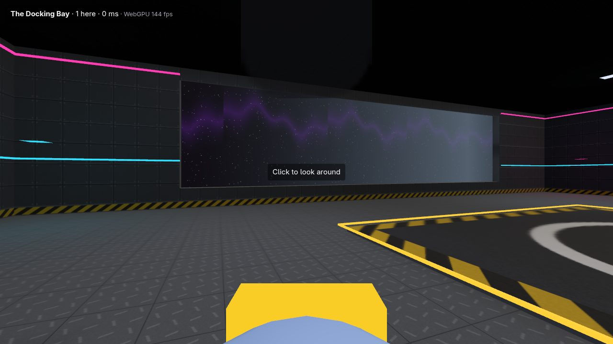
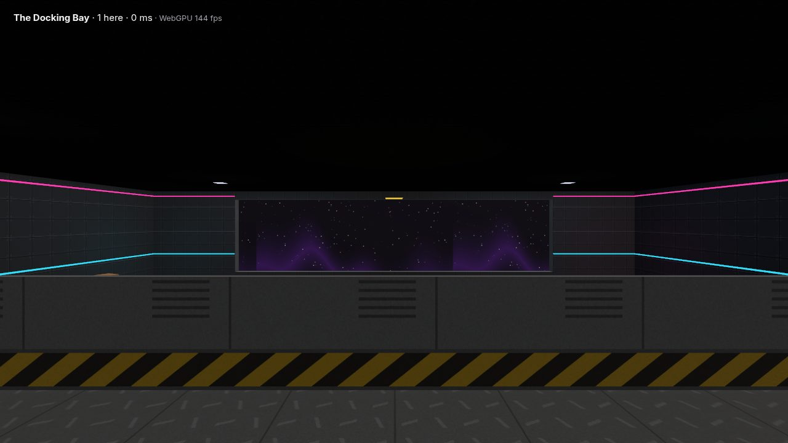
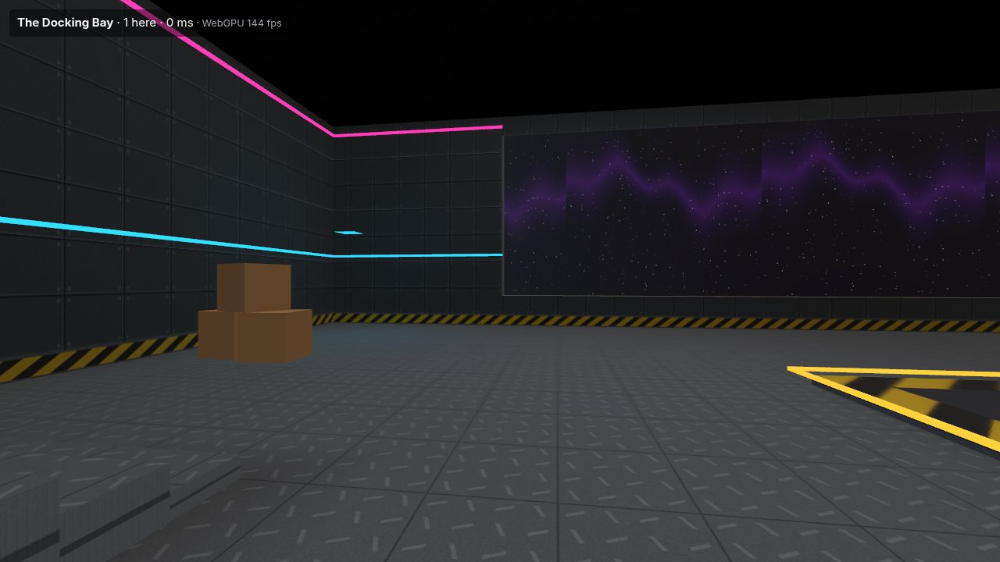
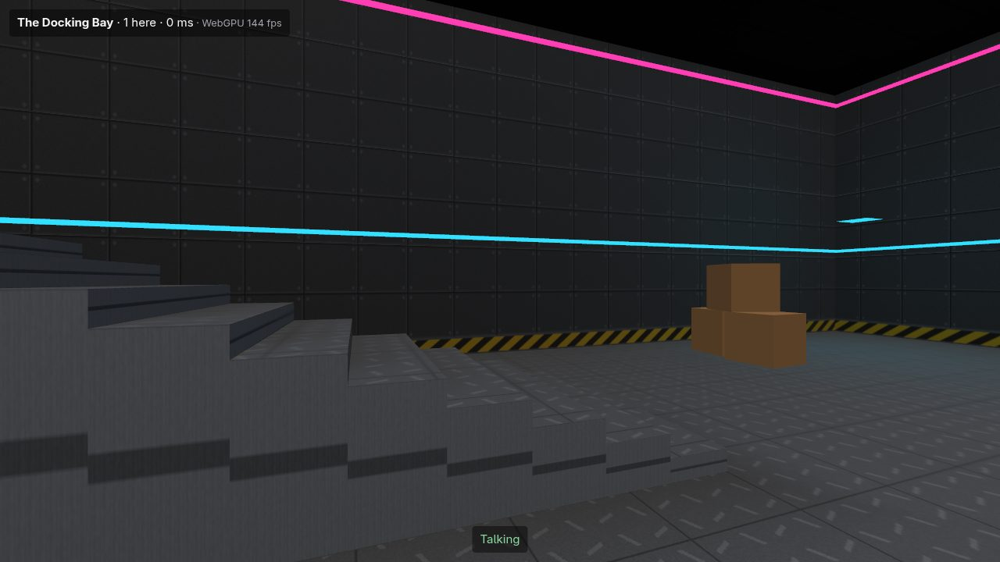
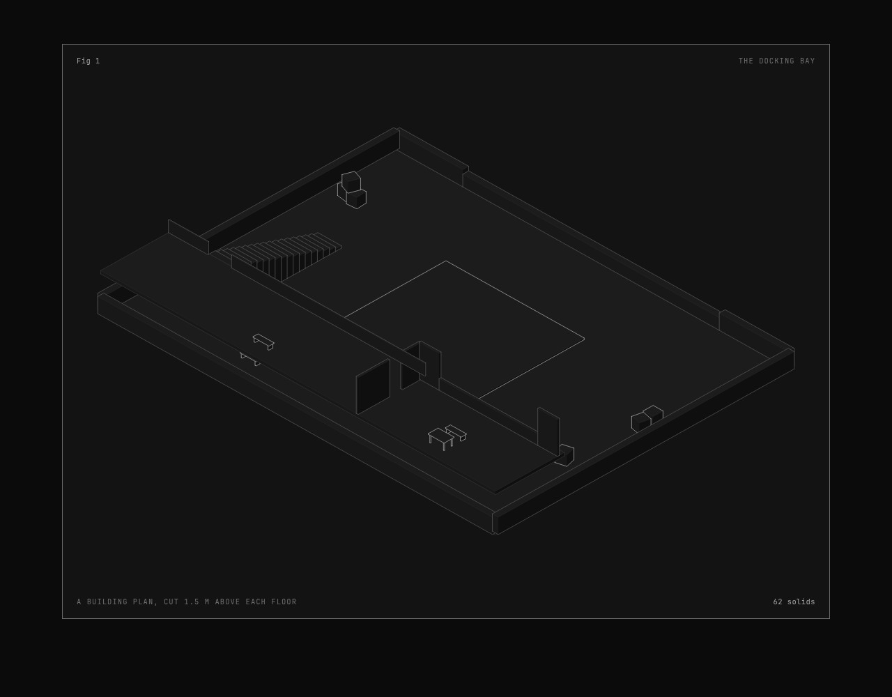
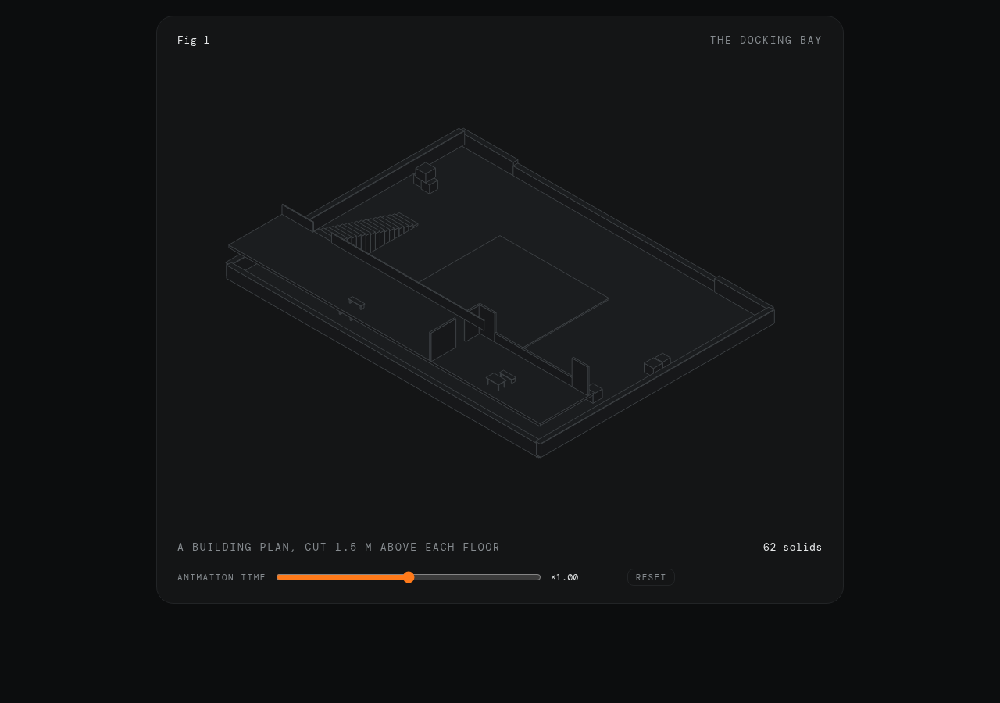

# S-SVG: buildings from SVG plans (Track P's P.01)

**Question.** Can a building be written as a semantic SVG plan, by an agent or in any SVG editor, and built into a low-poly glTF world the platform takes as it is? And which of the two picture-making skills should draw its previews (T-16)?

**Status.** Built and measured on the desktop on 2026-10-18. One docking-station room, the docking bay, is an 88-line plan that builds in 0.35 s into a 16,556-triangle world. It is drawn in 11 calls and weighs 322 KB once converted. The world format's validator and the host tool's converter take it with no warning, and the client plays it, offline mode included. Both skills draw its isometric preview from the same plan. Two calls are the owner's:

- **The laptop.** Its frame time on the reference laptop, or the stand-in.
- **The skill.** Which preview skill to keep.



## The plan

[kits/worlds/docking-bay/plan.svg](../../kits/worlds/docking-bay/plan.svg) is the source; [docs/svg-plans.md](../svg-plans.md) is the format.

- **Floors.** A layer per floor (`<g class="floor">` with its elevation and height). Each shape says what it is by its class and `data-` attributes: slabs, walls, openings, stairs, neon strips, props (the base library's parts), lights and spawn points.
- **Units.** The page is in tenths of a metre; heights, thicknesses and elevations are metres.
- **The bay.** A hangar 40 by 30 m and 8 m high on a station's rim:
  - a landing pad;
  - a 26 m bay window onto the stars, over a 1.1 m parapet;
  - a mezzanine along the south hull with a railing, and a control room with a window and a door;
  - 18 steps up to it;
  - neon along the hull, eight lights, cargo and benches;
  - space all round, 6 m out.
- **Arrivals.** Players arrive on the mezzanine or on the deck.



## The builder

`tools/converter/src/plan/` (`svg.ts`, `plan.ts`, `build.ts`, `materials.ts`), run by `node tools/converter/scripts/build-plan.ts PLAN.svg`.

- **Reading.** A 200-line reader takes the plan's subset of SVG: straight lines and transforms. It refuses a curve with where it is, and reports every problem in a plan at once.
- **Walls.** Each wall is a run of mitered pieces, cut around its openings (a sill below a window, a lintel over a door). Each piece is a solid box and a set of faces cut into cells of a metre.
- **Slabs.** Ear-clipped polygons: a box solid when rectangular, a triangle mesh otherwise.
- **Stairs.** Steps, each a box.
- **Textures.** A trim sheet drawn by the builder: one image whose bands are the hull's plates, the panels, a kick plate with hazard stripes and a metal trim. Faces map onto it by height, in strips, so it repeats along a wall and up it. Floors take a deck plate, the pad its markings, and space a star field that glows.
- **Light.** The plan's lights are baked into the vertex colours, with the shadows of walls, steps and slabs (rays against every solid), over a little ambient light.
- **One mesh per material.** The trim sheet, the deck, the ceiling, the pad, space and each neon colour make 11 draw calls for the whole room.

The plan named three.js's SVGLoader, Clipper2 and earcut. None was needed: the plan's subset reads in 200 lines without a browser, mitered boxes need no polygon clipping, and ear clipping is 40 lines. So the builder adds no dependency. Headless Blender, the fallback, was not needed either.



## The numbers (desktop, 2026-10-18)

| What | The docking bay |
|---|---|
| The plan | 88 lines, 7.2 KB |
| Building it | 0.35 s |
| Triangles drawn | 16,556 |
| Draw calls (materials) | 11 |
| Solids | 41 boxes: 19 wall pieces, 18 steps and 4 slabs (the deck, the pad, the mezzanine and the roof) |
| Base parts placed | 11 |
| The scene as built (PNG textures, float vertices) | 1.7 MB |
| Converted by the host tool (KTX2, meshopt) | 322 KB in all, in 2.4 s: the scene 303 KB, the solids 2.9 KB, the navigation mesh 13 KB |
| In the client (WebGPU, 1280 × 720) | 144 fps, the monitor's rate (no cap measured on the desktop) |
| On the reference laptop | the owner's run (below) |

A world warns above a million triangles, so the room uses 1.7 % of that line. A station of a dozen such rooms would still be under a fifth of it.



## The look

The look is industrial and dark: hull plates with rivets, panels with vents, hazard stripes at every wall's foot, cyan and magenta neon, and a landing pad with its ring and cross. The baked light pools under the lights and falls off into the corners. The house style is the owner's, in P.02. Three findings for Stage 6:

- **The client lights every world.** It adds its own sky light, sun and light blue-grey fog (from 40 m) to every world, made for the open plaza. Inside a sealed hangar the sun still lights every face, and the fog greys anything over 40 m away: the star field had to come in to 6 m outside the hull. A world's own sky, fog and lighting (or none) belong to S6.05's world effects.
- **No glass.** Windows are open holes; a glass material with the trust shields' cost is Stage 6's too.
- **Light by vertex.** Baked light lives in the vertex colours, a metre apart: soft, and cheap on the weak laptop, but its shadows are coarse. A lightmap would need a second set of texture coordinates and the client's support.

## The previews: anatomy or iso-figures (T-16)

`node tools/converter/scripts/plan-preview.ts PLAN.svg --with anatomy|iso-figures --kit DIR --out FILE` draws the plan's solids, as the builder makes them, as an isometric cut-away: walls taller than 4 m cut 1.5 m above their floor, no roof and no space. Neither skill is the plan's source: they are picture makers, as dp-007 has them. Neither is copied into this repository; the script reads each from its own folder.





| | anatomy (MIT, github.com/wheresryan22/anatomy) | iso-figures (the owner's skill) |
|---|---|---|
| Input | any ring extruded between two heights, from Node (`extrude`, `fitProjection`) | boxes along the axes, inside its figure page (`K.box`); a turned prop becomes its bounds, an angled wall would too |
| Output | a page or a standalone SVG, written by Node | a figure page that draws in the browser (its core is in the page) |
| Look | solids shaded by facing (four tones and a lighter top) | hairlines on flat faces, the owner's house style |
| Depth order | painted back to front by the adapter; its audit can settle true depth | painted back to front by the adapter |
| The adapter, after the shared cut-away | 7 lines | 31 lines (a figure block written into its page) |

The agents' recommendation is **anatomy for plan previews**: it takes any shape a plan has, shades walls so the rooms read, and writes a file from Node alone. iso-figures stays the house style for interactive figures and plates. The pick is the owner's.

## Left out, or for later

- **Not drawn yet.** Holes in slabs (draw the slab round them), curved walls, glass and doors that open.
- **Two kinds of world.** Each plan is one world, and the station is many rooms. A portal (`FLATCHAT_world`'s `portal`) can join plans: a plan class for it is the next small step.
- **The hangout world.** S7.03 builds it from the base library and this room.
- **The devlog.** The plan-to-room transformation clip is the owner's to record.

## The owner's run

On the reference laptop or the Iris Xe stand-in (`docs/spikes/s-avatar.md` has its setup):

```sh
npm run build -w @flatchat/client
node tools/converter/scripts/build-plan.ts kits/worlds/docking-bay/plan.svg
# the client's offline mode lists The Docking Bay among its built-in worlds; walk it and read the HUD's frame rate
```

The pass line is the game's: 30 fps at 720p on the low preset.
